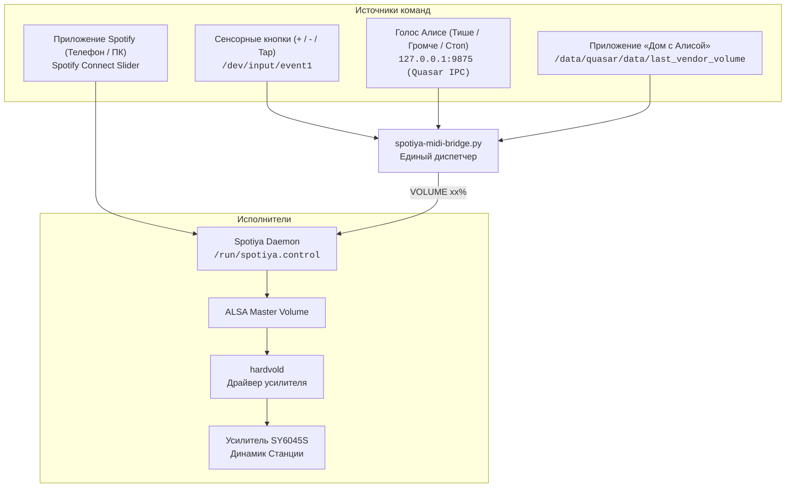

# 🎛️ Часть 5: Аппаратные кнопки (+ / − / Tap), Quasar IPC и 2-сторонняя синхронизация громкости

Даже после успешного запуска воспроизведения музыки на Станции 2 оставалась критическая проблема:
> *«Громкость на колонке регулируется (звуки Алисы тише/громче), но музыка из Spotify играет на фиксированной громкости и не реагирует на кнопки `+` и `−` или голос!»*

Здесь описано, почему это происходило и как кастомный мост [`spotiya-midi-bridge.py`](file:///data/opt/bin/spotiya-midi-bridge.py) полностью объединил аппаратную часть, Алису и Spotify в единое целое.

---

## 🔍 Анатомия регулировки звука на Станции 2

1. **Разрыв между Алисой и ALSA:**
   - На Станции 2 разработчики Яндекса привязали регулятор громкости Алисы (`volume_manager` / `volume_capability`) к программному элементу GStreamer `volume0`, который управляет **только штатным плеером Яндекс Музыки**.
   - Аппаратный усилитель колонки (`SY6045S`) управляется отдельным демоном `hardvold`, который слушает контроллер ALSA `Master Playback Volume`.
   - Сама Алиса **никогда не меняет ALSA `Master`**! Она лишь записывает текущий выбранный уровень (от 0 до 10) в системный файл `/data/quasar/data/last_vendor_volume`.
   - В результате: Spotify играл напрямую в ALSA, а Алиса крутила свой внутренний виртуальный ползунок, не влияя на реальный звук музыки.

2. **Аппаратные сенсорные кнопки:**
   - На Станции 2 (Миди) сенсорная панель подключена через SPI и выведена в ядро как `/dev/input/event1` (драйвер `midi_touch`, `sar0_pad0`):
     - Код `115`: кнопка **`+`** (`KEY_VOLUMEUP`);
     - Код `114`: кнопка **`−`** (`KEY_VOLUMEDOWN`);
     - Код `582`: центральная сенсорная кнопка (`KEY_VOICECOMMAND`);
     - `/dev/input/event0`, код `113`: физический тумблер отключения микрофонов на задней панели.

---

## 🚀 Архитектура демона `spotiya-midi-bridge.py`

Мы разработали легковесный асинхронный демон на Python, который работает на системном уровне (потребляет менее 0.05% CPU) и объединяет все источники управления:

### 1. Обработка сенсорных кнопок (`/dev/input/event1`)
- При нажатии **`+`** (код 115) → мост читает текущий уровень Spotify и прибавляет 5%.
- При нажатии **`−`** (код 114) → мост уменьшает громкость на 5%.
- При коротком касании центральной кнопки (код 582, длительность < 600 мс) → мост отправляет команду `TOGGLE` (Play/Pause). Длительное удержание (> 600 мс) пропускается дальше для штатного вызова голосового ассистента.

### 2. Мониторинг системного уровня Яндекса
Демон отслеживает файл `/data/quasar/data/last_vendor_volume`:
- Когда пользователь меняет громкость в приложении «Дом с Алисой» или голосом через стандартные фразы Алисы, Яндекс пишет уровень от `0` до `10`.
- Мост моментально пересчитывает его в проценты (например, уровень `4` → `40%`) и отправляет команду `VOLUME 40` в сокет `/run/spotiya.control`.

### 3. Перехват быстрых голосовых команд на Quasar IPC (порт 9875)
Демон подключается к локальному IPC-сокету голосового движка:
- Команды *«тише»*, *«потише»*, *«сделай тише»* уменьшают громкость на 10%;
- Команды *«громче»*, *«погромче»*, *«сделай громче»* увеличивают громкость на 10%;
- Команды *«громкость на 7»*, *«поставь громкость пять»* выставляют точный уровень;
- Короткие команды без слова «Алиса» (*«стоп»*, *«пауза»*, *«дальше»*, *«назад»*, *«продолжи»*) глушат диалог и сразу управляют Spotify.

### 4. Автоматическое приглушение звука (Ducking)
Когда пользователь начинает говорить с Алисой (*«Алиса, какая погода?»*), Spotiya автоматически снижает громкость музыки до минимума на время диалога и плавно восстанавливает её после завершения ответа.

---

## 🛠️ Запуск службы

Демон автоматически прописан в скриптах управления:
- Запуск: `/data/opt/spotify-connect/start.sh`
- Остановка: `/data/opt/spotify-connect/stop.sh`
- Журнал работы в реальном времени: `tail -f /tmp/spotiya-midi-bridge.log`
